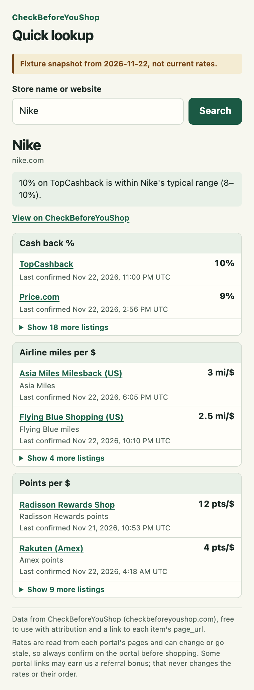
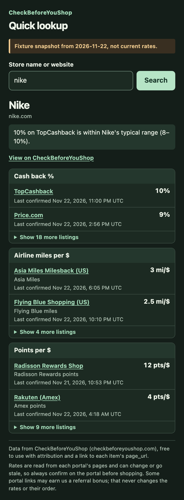
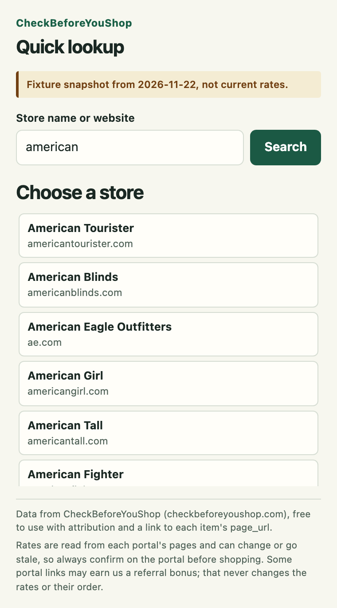
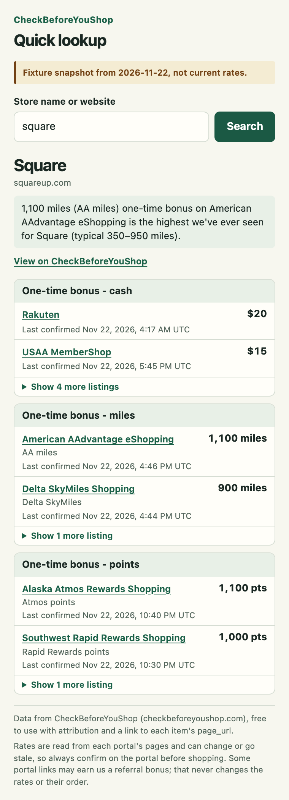
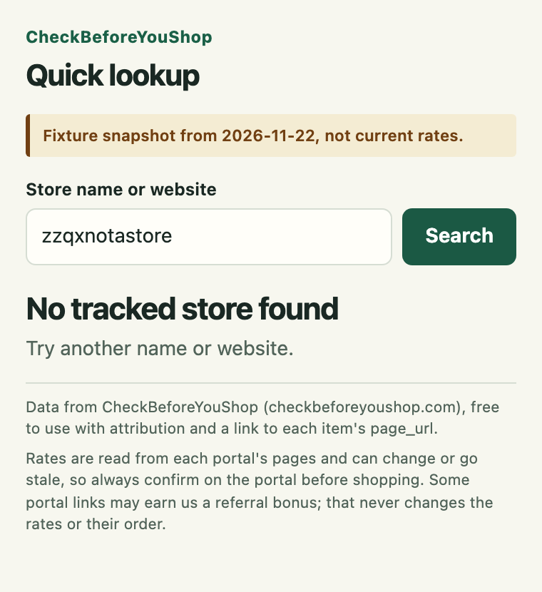
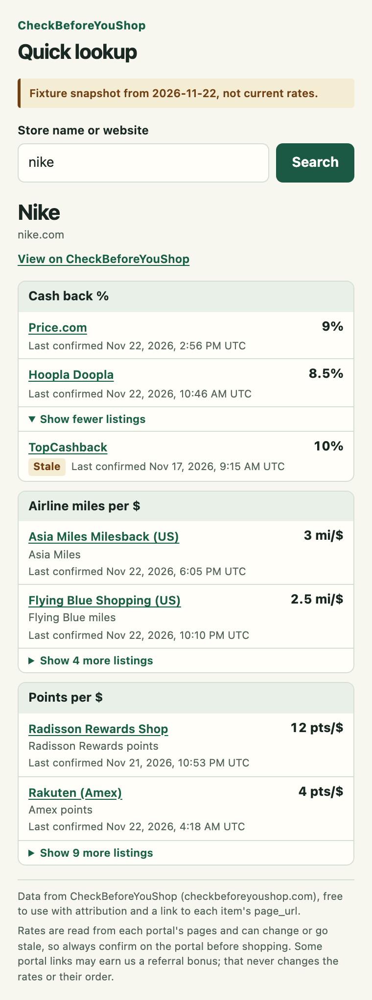
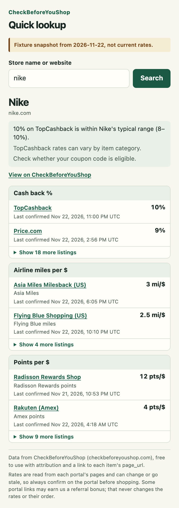

# CheckBeforeYouShop Quick Lookup

A local, unpacked Chrome extension prototype for the public CheckBeforeYouShop API. Search by store name, slug, or domain to see the store verdict and tracked portal listings.

## Load unpacked

1. Open `chrome://extensions` in Chromium or Chrome and enable **Developer mode**.
2. Click **Load unpacked** and select this project's `extension/chrome` directory.
3. Open the extension from the toolbar. On an HTTP or HTTPS tab with a domain, the search field starts with that tab's hostname. Edit it if needed and choose **Search**.
4. Choose a store if the lookup shows several matches. Expand a rate group to see the rest of its listings. The linked portal name opens the API's outbound link in a new tab.

The extension runs as shipped, with no build step or runtime dependencies. Distribution is limited to local unpacked installs.

### Permissions

- `activeTab` lets the popup read the active tab's URL when you open it from the toolbar. The popup uses the hostname to fill the search field. Browser-internal pages and other restricted tabs support manual lookup.
- `https://checkbeforeyoushop.com/*` allows requests to the public JSON API. The popup sends the search text when you submit and requests store details after resolving a match. It omits cookies and uses no account, browser storage, content scripts, or background worker.
- The extension's Content Security Policy limits scripts and styles to packaged files and limits fetches to the CheckBeforeYouShop origin. Portal links open on activation with the original `go_url`, including its attribution parameter.

### What the popup shows

A unique exact slug, name, or domain match opens directly. A partial match or a shared domain prompts you to choose a store, even if there is only one partial match. The API search returns up to 25 results, including portals, which the popup filters out. A tracked store may have no listing for a particular portal.

Each group shows rates in their original units, with one-time bonuses in their own groups. Fresh listings appear before stale ones. For listings with the same freshness and value, an exact rate appears ahead of an “up to” rate. When the API provides a supported category rate, the popup shows it alongside the advertised maximum and uses the category rate for sorting. Each listing shows its own last confirmation in UTC. Stale rows carry a visible label. Verdict caveats appear below the headline. Store links, attribution, and disclosure come from the API.

## Offline demo

Open [demo/index.html](demo/index.html) in a browser from disk or serve the `extension` directory with a local static server and visit `/demo/`. Try **Nike**, **Square**, **American**, or **zzqxnotastore**. For a successful picker selection, search **Delta** and choose **Delta Air Lines**.

The banner dates the fixture snapshot. Queries and store details absent from the snapshot show a fixture error. The demo makes no API calls. Store and portal links work when opened explicitly.

The committed `demo/fixtures.js` bundles the search and merchant responses recorded in `../fixtures/live-2026-11-22`. Regenerate it with `npm run fixtures` from `extension/`. Set `CBYS_FIXTURES_DIR` before running that command to use a different local fixture directory with a matching manifest.

## Tests and screenshots

Use Node.js 20 or later. From `extension/`:

```sh
npm ci
npx playwright install chromium
npm test
npm run screenshots
```

Playwright checks the demo over `file://` and opens the installed extension from Chromium's toolbar in a persistent headless context. The extension test intercepts network requests and serves committed fixtures, including replaying captured results for a domain search and a slug lookup. The stale screenshot uses a synthetic stale flag and timestamp on Nike's TopCashback listing. The caveat screenshot uses synthetic verdict caveats.

| Nike, light | Nike, dark |
| --- | --- |
|  |  |
| **Candidate picker** | **Square bonuses** |
|  |  |
| **No tracked store** | **Stale listing** |
|  |  |
| **Verdict caveats** | |
|  | |
